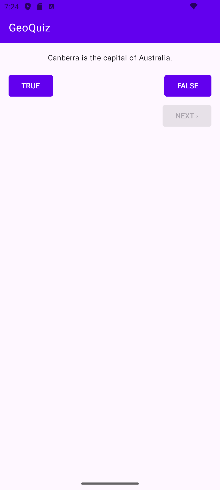
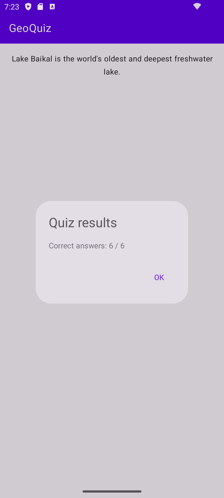

# GeoQuiz — лабораторная работа №4

## Тема и цель
Географическая викторина по оригинальному `Lab 4 GeoQuiz.pdf` (1 страница, включая изображение интерфейса). Цель — работа с состоянием интерфейса, обработка ответов, безопасная навигация и подсчёт результата.

## Вопросы — дословно из PDF
| № | Утверждение | Ответ |
|---|---|---|
| 1 | Canberra is the capital of Australia. | true |
| 2 | The Pacific Ocean is larger than the Atlantic Ocean. | true |
| 3 | The Suez Canal connects the Red Sea and the Indian Ocean. | false |
| 4 | The source of the Nile River is in Egypt. | false |
| 5 | The Amazon River is the longest river in the Americas. | true |
| 6 | Lake Baikal is the world's oldest and deepest freshwater lake. | true |

## Поведение
- TRUE/FALSE исчезают после ответа: это именно скрытие, не только disabled.
- Ответ записывается один раз. Повторный вызов обработчика не изменяет выбор или счёт.
- NEXT переводит к следующему вопросу; после последнего ответа удаляется из интерфейса. Модель также запрещает выход за последний индекс.
- Сразу после ответа №6 открывается `AlertDialog` с количеством правильных ответов из 6. После закрытия результат остаётся на экране.
- Дополнительная защита: до ответа NEXT неактивна, поэтому нельзя пропускать вопросы. На рисунке PDF она показана активной; запрет пропуска — явно обозначенное улучшение, не требование PDF.
- `rememberSaveable` с `listSaver` сохраняет индекс, ответы и состояние диалога при пересоздании Activity. Холодный запуск после принудительной остановки начинает новую викторину; постоянная история попыток не предусмотрена заданием.
- Структура макета повторяет PDF: фиолетовая панель GeoQuiz, вопрос по центру, ответы по краям и NEXT справа. Использован современный Compose Material 3 вместо старого виджета с рисунка; точное совпадение пикселей не заявляется.

## Технологии и запуск
Kotlin, Jetpack Compose, Material 3; package `com.example.geoquiz`. Gradle 9.6.0, AGP 9.4.1, Compose plugin 2.2.10, BOM 2026.02.01. `minSdk 27`, compileSdk/targetSdk 37: в PDF версии не закреплены, использована уже доступная сборочная конфигурация курса без обновления SDK.

Открыть `C:/AndroidProjects/GeoQuiz` в Android Studio. В локальном, исключённом из Git `local.properties`: `sdk.dir=C\:/Android/Sdk`.

Windows cmd (переменная только для текущего процесса):
```bat
set "JAVA_HOME=C:\Program Files\Android\Android Studio\jbr"
gradlew.bat :app:assembleDebug :app:assembleDebugAndroidTest :app:lintDebug
C:\Android\Sdk\platform-tools\adb.exe install -r app\build\outputs\apk\debug\app-debug.apk
C:\Android\Sdk\platform-tools\adb.exe install -r app\build\outputs\apk\androidTest\debug\app-debug-androidTest.apk
C:\Android\Sdk\platform-tools\adb.exe shell am instrument -w -r com.example.geoquiz.test/androidx.test.runner.AndroidJUnitRunner
```

Прямой AndroidJUnitRunner использован намеренно: в предыдущих лабораторных Gradle Worker на этой машине не запускался из-за кодировки кириллического пути Gradle home. В GeoQuiz системные настройки не менялись, `connectedDebugAndroidTest` не выдаётся за выполненный. Все 10 тестов действительно выполнены на устройстве, а не только скомпилированы.

## Соответствие заданию и история
| Требование / этап | Файл | Коммит | Проверка |
|---|---|---|---|
| Независимый проект | Gradle, MainActivity.kt | `903081e` Создан каркас приложения GeoQuiz на Compose | assembleDebug PASS |
| Все 6 вопросов и ключ | Question.kt | `d97678d` Добавлены шесть вопросов и ответы из оригинального задания | QuestionBankTest: дословная таблица и ключ PASS |
| Подсчёт, единственный ответ, граница индекса | QuizState.kt | `d8d3e37` Реализованы подсчёт баллов и защита от повторных ответов | 3 теста, включая 64 комбинации PASS |
| Скрытие True/False, навигация | GeoQuizScreen.kt | `3983724` Добавлены кнопки ответов, навигация и сохранение состояния | 3 UI-теста PASS |
| Результат во всплывающей панели | GeoQuizScreen.kt | `702748a` Добавлены итоговая панель и проверки полного прохождения викторины | Полный набор 10 тестов PASS |
| Документация и приёмка | README.md, docs/screenshots | Финальный коммит «Завершение лабораторной работы №4» | сохранённые логи и реальные скриншоты |

Каждый этап собран до коммита. Для модели/вопросов сохранены тесты до реализации с ошибками отсутствующего API (compile RED). Для интерфейса и результата сохранены реальные runtime RED на отсутствующем вопросе/диалоге, затем GREEN; эти виды проверок не смешиваются.

## Фактические результаты
- `assembleDebug`, `assembleDebugAndroidTest`: BUILD SUCCESSFUL.
- Pixel_API_34, Android 14/API 34: **OK (10 tests)**.
- Проверены 6/6, 0/6, 3/6; повторные ответы; запрет пропуска и выхода за последний вопрос; исчезновение кнопок; восстановление после `Activity.recreate()`, включая открытый и закрытый результат.
- Lint: **0 ошибок, 7 предупреждений** — 5 GradleDependency, DataExtractionRules, MissingApplicationIcon. Зафиксированные зависимости не обновлялись, предупреждения не подавлялись. Приложение не запрашивает разрешений и не сохраняет личные данные.
- UI просмотрен по настоящим скриншотам первого экрана и итогового диалога. Первый автоматический снимок захватил стартовый пустой кадр; для документации взят повторный снимок после реального запуска и отрисовки, тесты ради этого не повторялись.
- Полные локальные доказательства: `C:/AndroidProjects/_lab04_evidence/01.log`–`05.log`, `02-tests.log`–`05-tests.log`, журналы RED и PNG. В Git не включены исходный PDF, APK, кэши, local.properties и секреты.




## Краткая теория для защиты
1. **Почему состояние отдельно от UI?** QuizState хранит правила; Compose отображает его и посылает действия.
2. **Почему счёт вычисляется из ответов?** Это исключает повторное начисление при повторном нажатии или перерисовке.
3. **Чем скрытие отличается от disabled?** Условная композиция удаляет кнопку из UI и семантического дерева; disabled оставляет видимый элемент.
4. **Как предотвращён выход за границы?** next() проверяет answered и index < lastIndex независимо от кнопки.
5. **Зачем rememberSaveable?** Сохраняет небольшое состояние через SavedInstanceState при пересоздании Activity; listSaver переводит модель в список целых чисел.
6. **Что доказывают instrumented-тесты?** Они выполняют реальные нажатия и проверяют UI Android-приложения на эмуляторе, а не только Kotlin-код.

## Публикация
Подготовлено для отдельного публичного репозитория `ZolotkoVal/GeoQuiz`. Создание и push выполняются только после отдельного подтверждения пользователя. Лицензия автоматически не назначалась.
